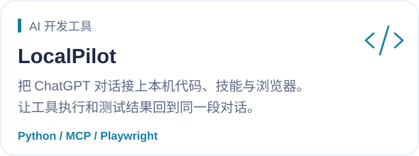
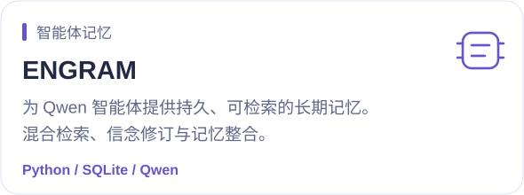
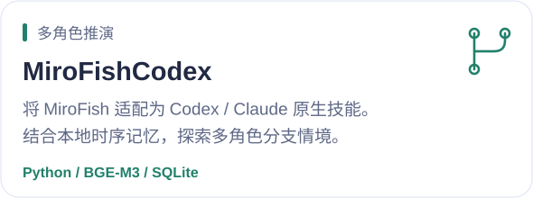
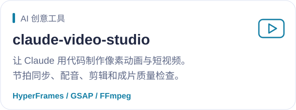
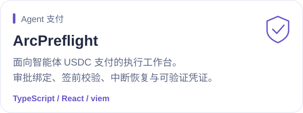
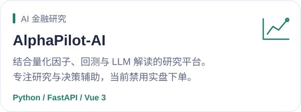

<picture>
  <source media="(max-width: 640px)" srcset="assets/hero-mobile.svg">
  <source media="(prefers-color-scheme: dark)" srcset="assets/hero-dark.svg">
  
</picture>

我在做能连接真实工具、保留长期记忆、完成实际任务的 AI 系统。
从开发者工具到视频创作，从多角色推演到 Agent 支付，把想法写成可运行的项目。

**AI 工程 · 智能体工具 · 开源实验** &nbsp; | &nbsp; [个人网站](https://www.axiqo.xyz/) &nbsp; · &nbsp; [所有项目](https://github.com/a252937166?tab=repositories)

### Projects I'm building

<table>
  <tr>
    <td width="50%"><a href="https://github.com/a252937166/LocalPilot"><picture><source media="(max-width: 640px) and (prefers-color-scheme: dark)" srcset="assets/localpilot-mobile-dark.svg"><source media="(max-width: 640px)" srcset="assets/localpilot-mobile-light.svg"><source media="(prefers-color-scheme: dark)" srcset="assets/localpilot-dark.svg"></picture></a></td>
    <td width="50%"><a href="https://github.com/a252937166/engram"><picture><source media="(max-width: 640px) and (prefers-color-scheme: dark)" srcset="assets/engram-mobile-dark.svg"><source media="(max-width: 640px)" srcset="assets/engram-mobile-light.svg"><source media="(prefers-color-scheme: dark)" srcset="assets/engram-dark.svg"></picture></a></td>
  </tr>
  <tr>
    <td width="50%"><a href="https://github.com/a252937166/MiroFishCodex"><picture><source media="(max-width: 640px) and (prefers-color-scheme: dark)" srcset="assets/mirofishcodex-mobile-dark.svg"><source media="(max-width: 640px)" srcset="assets/mirofishcodex-mobile-light.svg"><source media="(prefers-color-scheme: dark)" srcset="assets/mirofishcodex-dark.svg"></picture></a></td>
    <td width="50%"><a href="https://github.com/a252937166/claude-video-studio"><picture><source media="(max-width: 640px) and (prefers-color-scheme: dark)" srcset="assets/claude-video-studio-mobile-dark.svg"><source media="(max-width: 640px)" srcset="assets/claude-video-studio-mobile-light.svg"><source media="(prefers-color-scheme: dark)" srcset="assets/claude-video-studio-dark.svg"></picture></a></td>
  </tr>
  <tr>
    <td width="50%"><a href="https://github.com/a252937166/arcpreflight"><picture><source media="(max-width: 640px) and (prefers-color-scheme: dark)" srcset="assets/arcpreflight-mobile-dark.svg"><source media="(max-width: 640px)" srcset="assets/arcpreflight-mobile-light.svg"><source media="(prefers-color-scheme: dark)" srcset="assets/arcpreflight-dark.svg"></picture></a></td>
    <td width="50%"><a href="https://github.com/a252937166/AlphaPilot-AI"><picture><source media="(max-width: 640px) and (prefers-color-scheme: dark)" srcset="assets/alphapilot-mobile-dark.svg"><source media="(max-width: 640px)" srcset="assets/alphapilot-mobile-light.svg"><source media="(prefers-color-scheme: dark)" srcset="assets/alphapilot-dark.svg"></picture></a></td>
  </tr>
</table>

还在探索：[Codex ↔ ChatGPT 网页桥接](https://github.com/a252937166/codex-chatgpt-web-bridge)（Alpha / 研究用途） · [Agent 内容授权](https://github.com/a252937166/license402)

### My toolkit

<picture>
  <source media="(max-width: 640px) and (prefers-color-scheme: dark)" srcset="assets/toolkit-mobile-dark.svg"><source media="(max-width: 640px)" srcset="assets/toolkit-mobile-light.svg"><source media="(prefers-color-scheme: dark)" srcset="assets/toolkit-dark.svg">
  
</picture>

### Build log

<picture>
  <source media="(max-width: 640px) and (prefers-color-scheme: dark)" srcset="assets/activity-mobile-dark.svg"><source media="(max-width: 640px)" srcset="assets/activity-mobile-light.svg"><source media="(prefers-color-scheme: dark)" srcset="assets/activity-dark.svg">
  
</picture>

数据来自 GitHub API，每日更新。语言分布按非 Fork 公开仓库的主语言计数；贡献统计沿用 GitHub 的贡献日历口径。

---

<b>让模型走出对话框，让想法落到代码里。</b>

