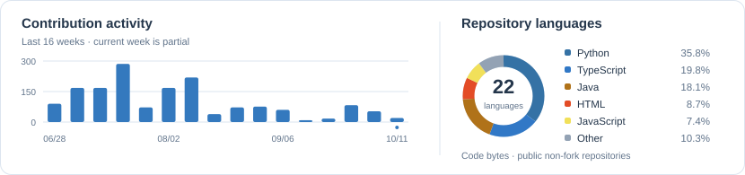

<picture>
  <source media="(max-width: 640px) and (prefers-color-scheme: dark)" srcset="assets/identity-mobile-dark.svg">
  <source media="(max-width: 640px)" srcset="assets/identity-mobile-light.svg">
  <source media="(prefers-color-scheme: dark)" srcset="assets/identity-dark.svg">
  
</picture>

[Website](https://www.axiqo.xyz/) &nbsp; / &nbsp; [Browse repositories](https://github.com/a252937166?tab=repositories)

### Selected projects

<a href="https://github.com/a252937166/faktura-casper"><picture><source media="(prefers-color-scheme: dark)" srcset="assets/faktura-dark.svg"></picture></a> &nbsp; <a href="https://github.com/a252937166/croocred"><picture><source media="(prefers-color-scheme: dark)" srcset="assets/croocred-dark.svg"></picture></a> &nbsp; <a href="https://github.com/a252937166/claude-video-studio"><picture><source media="(prefers-color-scheme: dark)" srcset="assets/video-dark.svg"></picture></a>

Award announcements: <a href="https://www.linkedin.com/posts/casper-association_meet-the-winners-of-the-casper-agentic-buildathon-activity-7508434074051457024-yBSr">Casper Association</a> · <a href="https://x.com/CROONetwork/status/2080195168687526173">CROO Network</a>

### Code & activity

<picture>
  <source media="(max-width: 640px) and (prefers-color-scheme: dark)" srcset="assets/stats-mobile-dark.svg">
  <source media="(max-width: 640px)" srcset="assets/stats-mobile-light.svg">
  <source media="(prefers-color-scheme: dark)" srcset="assets/stats-dark.svg">
  
</picture>

<!-- snapshot-date -->Updated 2026-10-11<!-- /snapshot-date --> · Scheduled to refresh daily

About these numbers

Public repositories include forks. Repository stars count stars received by my own public non-fork repositories. The contribution chart covers the last 16 weeks; the current week is incomplete. The profile contribution total covers GitHub's rolling year.

Language percentages use GitHub Linguist code bytes across my public non-fork repositories, including archived projects. They describe the repositories, rather than coding proficiency.

[Data snapshot](data/profile.json) · [Refresh workflow](https://github.com/a252937166/a252937166/actions/workflows/profile-stats.yml)

