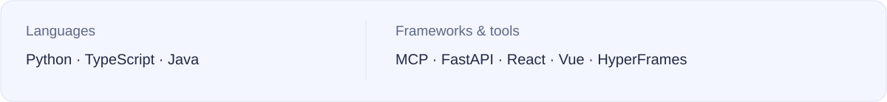
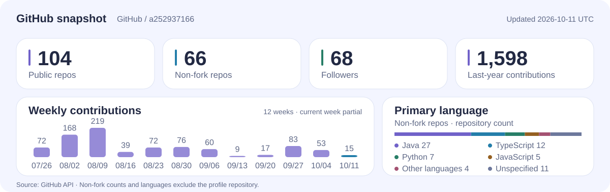

<picture>
  <source media="(max-width: 640px)" srcset="assets/hero-mobile.svg">
  <source media="(prefers-color-scheme: dark)" srcset="assets/hero-dark.svg">
  
</picture>

这里放我做的 AI 工具和一些实验。 [个人网站](https://www.axiqo.xyz/) · [所有仓库](https://github.com/a252937166?tab=repositories)

### 项目

<table>
  <tr>
    <td width="50%" valign="top">
      
<strong><a href="https://github.com/a252937166/LocalPilot">LocalPilot</a></strong> 让 ChatGPT 调用本机代码和浏览器，执行结果直接回到对话里。

      Python · MCP · Playwright
    </td>
    <td width="50%" valign="top">
      
<strong><a href="https://github.com/a252937166/engram">ENGRAM</a></strong> Qwen 智能体的长期记忆库，可以检索已有记忆，也能修订旧记录。

      Python · SQLite · Qwen
    </td>
  </tr>
  <tr>
    <td width="50%" valign="top">
      
<strong><a href="https://github.com/a252937166/MiroFishCodex">MiroFishCodex</a></strong> 基于 MiroFish 的 Codex / Claude 技能，结合本地时序记忆做多角色推演。

      Python · BGE-M3 · SQLite
    </td>
    <td width="50%" valign="top">
      
<strong><a href="https://github.com/a252937166/claude-video-studio">claude-video-studio</a></strong> 用代码做像素动画和短视频，带配音和成片检查。

      HyperFrames · GSAP · FFmpeg
    </td>
  </tr>
  <tr>
    <td width="50%" valign="top">
      
<strong><a href="https://github.com/a252937166/arcpreflight">ArcPreflight</a></strong> 智能体 USDC 支付工作台，提供签前校验和中断恢复。

      TypeScript · React · viem
    </td>
    <td width="50%" valign="top">
      
<strong><a href="https://github.com/a252937166/AlphaPilot-AI">AlphaPilot-AI</a></strong> 用量化因子和 LLM 做股票研究，提供回测，禁用实盘下单。

      Python · FastAPI · Vue 3
    </td>
  </tr>
</table>

其他项目：[Codex ↔ ChatGPT 网页桥接](https://github.com/a252937166/codex-chatgpt-web-bridge)（Alpha / 研究用途） · [Agent 内容授权](https://github.com/a252937166/license402)

### 技术栈

<picture>
  <source media="(max-width: 640px) and (prefers-color-scheme: dark)" srcset="assets/toolkit-mobile-dark.svg">
  <source media="(max-width: 640px)" srcset="assets/toolkit-mobile-light.svg">
  <source media="(prefers-color-scheme: dark)" srcset="assets/toolkit-dark.svg">
  
</picture>

### GitHub 数据

<picture>
  <source media="(max-width: 640px) and (prefers-color-scheme: dark)" srcset="assets/activity-mobile-dark.svg">
  <source media="(max-width: 640px)" srcset="assets/activity-mobile-light.svg">
  <source media="(prefers-color-scheme: dark)" srcset="assets/activity-dark.svg">
  
</picture>

数据来自 GitHub API，每日更新。语言分布按非 Fork 公开仓库的主语言计数，贡献数来自 GitHub 贡献日历。
